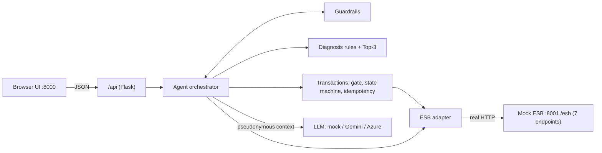

# Asisten Kuota — Prototype (MVP)

**Asisten Kuota** is an AI agent for MyTelkomsel prepaid customers that can **act**, not only answer: it diagnoses quota / FUP / network problems, recommends an eligible package, buys it **only after the customer taps a confirmation button**, offers **Paket Darurat** when pulsa is short, and creates a **network ticket** or **hands off to a human** when needed. Integration is only through a (mock) **ESB** using the brief's 7-endpoint contract, with idempotent retries, PII masking, a per-conversation cost cap and a full step-by-step trace.

🎥 **Demo video (≤ 3 min):** `<link to be added>`

---

## 1. Quick start (under 5 minutes, no API key needed)

**Prerequisites:** Python **3.11 or newer** (3.12 recommended; on Windows tick *"Add python.exe to PATH"* during install), Git, Chrome or Edge.

```bash
git clone <repo-url> asisten-kuota
cd asisten-kuota
python -m venv .venv
# macOS/Linux:
source .venv/bin/activate
# Windows (PowerShell):
.venv\Scripts\Activate.ps1
pip install -r requirements.txt
cp .env.example .env            # Windows: copy .env.example .env
python app.py
```
You should see:
```
Mock ESB : http://localhost:8001/esb
Chat UI  : http://localhost:8000   (LLM: mock/mock-scripted)
```
Open **http://localhost:8000**.

**Run without any API key:** `.env.example` defaults to `LLM_PROVIDER=mock`, a deterministic scripted LLM. Everything (tool calls, guardrails, ESB, trace) works offline.

**Check that it works:** choose **P1 - Kuota habis** → **Mulai sesi** → type `Kuota saya habis` → you get a diagnosis card, 3 package cards and a recommendation → tap **Pilih paket ini** → a confirmation card appears → tap **Konfirmasi** → "Paket … sudah aktif". The right panel shows every step (LLM call, tool call, ESB call, state change, guardrail) and the cost meter.

**Troubleshooting**
| Problem | Fix |
|---|---|
| `OSError: [Errno 98/48] Address already in use` | Another program uses port 8000 or 8001. Change `APP_PORT` / `ESB_PORT` in `.env`, and if you change `ESB_PORT` also change `[esb] base_url` in `config.toml`. |
| Reply "Maaf, sistem AI sedang mengalami kendala" with Gemini | `LLM_API_KEY` missing or wrong, or `LLM_BASE_URL` mistyped. Check `.env`; the trace shows `LLM error -> fallback: LLM HTTP 4xx`. Set `LLM_PROVIDER=mock` to continue the demo. |
| Reply "layanan AI sedang sibuk" | Free-tier rate limit (HTTP 429). The app waited once and gave up gracefully. Wait a minute, switch to `gemini-3.5-flash-lite`, or use `LLM_PROVIDER=mock`. |

## 2. Switching the LLM provider (edit `.env` only, no code change)

```ini
# Demo-safe / tests (default)
LLM_PROVIDER=mock
LLM_MODEL=mock-scripted

# Recommended free tier: Google Gemini (OpenAI-compatible endpoint)
LLM_PROVIDER=openai_compatible
LLM_BASE_URL=https://generativelanguage.googleapis.com/v1beta/openai
LLM_MODEL=gemini-3.8-flash              # if quota runs out: gemini-3.5-flash-lite
LLM_API_KEY=<key from aistudio.google.com → Get API key>
LLM_REASONING_EFFORT=low
LLM_BILLING=free

# Production target: Azure OpenAI GPT-4o-mini
LLM_PROVIDER=azure_openai
LLM_BASE_URL=https://<your-resource>.openai.azure.com
LLM_MODEL=<deployment-name>
LLM_API_VERSION=<GA api-version from your Azure portal>
LLM_API_KEY=<azure-key>
LLM_BILLING=paid

# Local model (any OpenAI-compatible server, e.g. Ollama)
LLM_PROVIDER=openai_compatible
LLM_BASE_URL=http://localhost:11434/v1
LLM_MODEL=<local-model-with-tool-calling>
LLM_API_KEY=local
```
Restart `python app.py` after editing. The active provider/model is shown at the top of the trace panel.
**Guardrails behave the same on every provider**: they are deterministic code, not prompt instructions.
Note: the free Gemini tier may use submitted content to improve Google products. This prototype sends only dummy, pseudonymised data; production would use Azure OpenAI (AD-1).

## 3. Demo personas and script

| Persona | Condition | Type this | What to point at |
|---|---|---|---|
| **P1** | Quota 0 MB, pulsa Rp 75.000 | `Kuota saya habis` → **Pilih paket ini** → type `ya` → **Konfirmasi** | Typing "ya" buys nothing; only the button does. Trace: `AWAITING_CONFIRMATION → CONFIRMED → SUBMITTING → SUCCEEDED` |
| **P2** | Quota left, FUP throttled | `Internet saya lambat` | Diagnosis FUP_THROTTLED → booster recommended, **no network ticket** |
| **P3** | Quota 0, pulsa Rp 2.000, Paket Darurat eligible | `Kuota habis` → **Konfirmasi** | Fee and total on the card; `payment_method=PAKET_DARURAT` |
| **P4** | Quota/FUP normal, cell degraded | `Sinyal jelek` → **Buat laporan** → `Payah banget!!!` → `Kalian tidak becus` | No package offered (upsell suppressed); ticket number; apology once, then handoff with masked summary |
| **P5** | No consent yet, pulsa low, not loan-eligible, purchase times out once | **Setuju** → `Kuota habis` → **Pilih paket ini** (Internet 2GB) → **Konfirmasi** | Trace: `timeout` → `UNKNOWN` → retry with **SAME Idempotency-Key** → `idempotent replay` → **one charge** |

Full timed script: [`docs/DEMO_SCRIPT.md`](docs/DEMO_SCRIPT.md). **Reset demo** (top right) reseeds all data.

## 4. Architecture summary


- Two servers, one command (`python app.py`): app (UI + API) on **8000**, mock ESB on **8001**, so the ESB behaves like a separate system. The backend reaches it **only** through `core/esb_adapter.py`.
- D2 design (AD-1…AD-8) is the target; this MVP implements the agreed essential subset. See *Roadmap* for what is deferred.

| D2 component | File | MVP status |
|---|---|---|
| Chat UI | `static/index.html`, `app.js`, `style.css` | Essential (polish deferred: DEF-09) |
| Conversation API + session | `api/routes.py`, `core/session.py` | Essential |
| Agent orchestrator | `core/agent.py` | Essential (history trim simplified) |
| Configurable LLM | `core/llm_client.py`, `core/mock_llm.py` | Essential (Azure path untested, no key) |
| Agent tools | `core/tools.py` | Essential |
| Diagnosis rules engine | `core/diagnosis.py` | Essential (ranking simplified) |
| Policy & guardrails | `core/guardrails.py` | Essential / simplified (DEF-05, 06, 07, 10, 11) |
| Transaction store + gate | `core/transactions.py` | Essential (DEF-02) |
| ESB adapter | `core/esb_adapter.py` | Essential (DEF-01, DEF-04) |
| PII masker | `core/privacy.py` | Essential |
| Trace + cost meter | `core/trace.py` | Essential (DEF-03) |
| Mock ESB | `mock_esb/server.py`, `data/esb_customers.json` | Essential (DEF-04, DEF-12) |
| Config | `config.toml`, `.env`, `core/config.py` | Essential |

Code walkthrough for reviewers: [`docs/CODE_WALKTHROUGH.md`](docs/CODE_WALKTHROUGH.md).

## 5. Agent tools and guardrails

| Tool | Type | LLM fills | System fills |
|---|---|---|---|
| `get_quota` | read | — | MSISDN |
| `get_network_status` | read (adds deterministic diagnosis) | — | MSISDN → cell |
| `get_offers` | read (Top-3 only; empty if network degraded) | — | MSISDN, diagnosis |
| `check_paket_darurat` | read | offer_id | price/amount |
| `purchase` | **GATED** (shows confirmation card only) | offer_id, payment_method | confirmation_id, transaction_id, Idempotency-Key |
| `create_ticket` | **GATED** | symptom | cell, evidence, key |
| `request_handoff` | escalate only | reason | masked summary, ref ID |

`get_profile` is **not** an LLM tool: the system calls it at session start for the consent check.

**Guardrails (deterministic, in code):**
- **Confirmation gate (AD-4):** a purchase or ticket runs only from `POST /api/confirm`, called by the button. The `confirmation_id` is single-use and expires after 5 minutes; a double tap is rejected. Typed "ya" is just text.
- **Idempotency (AD-5):** 1 confirmation = 1 `transaction_id` + 1 `Idempotency-Key`. Retries reuse both. The mock ESB replays the original result (`idempotent_replay=true`) without charging again.
- **Purchase lock:** no second purchase while one is `SUBMITTING`, `UNKNOWN` or `PENDING_VERIFICATION`.
- **Offer whitelist:** the LLM can only buy or mention offers from the Top-3. Replies that mention any other offer ID are replaced.
- **Upsell suppression:** no offers when the network is degraded.
- **Tickets only for real network problems:** `create_ticket` is refused unless the diagnosis is `NETWORK_DEGRADED`.
- **Consent:** checked at session start. "Not asked" → consent card; refused → non-AI menu, no AI processing.
- **Masking:** see §7. **Cost cap:** see §8.
- **Handoff:** customer asks for a human; anger persists after one apology; cost cap reached; purchase stuck in `PENDING_VERIFICATION`; ticket fails twice; LLM unavailable (customer presses *Hubungi petugas*); the LLM itself requests it. The human receives a **masked summary + ref ID**.
- **Prompt-injection filter (simplified):** regex patterns refuse the message without any LLM call. The structural defences above are the real protection.

## 6. API integration and error handling

- **Contract:** the 7 brief endpoints with exact paths and methods under `/esb`. ESB envelope on POST bodies and all responses (`transaction{transaction_id, channel, status_code, status_desc}`). Headers: API key, `x-signature = md5(api_key + secret + timestamp)`, `T-Status` (profile), `Idempotency-Key` (purchase, ticket).
- **Timeouts** per endpoint (`[esb.timeouts_s]`, e.g. purchase 5 s, quota 1.5 s). `/quota` has simulated 200–800 ms latency.
- **Retry only transient errors** (timeout, 502, 500/40000, 503). Never retry 20xxx/30xxx business errors.
  - Reads: up to 2 retries with exponential backoff 0.3 s / 0.9 s ± 30% jitter.
  - Writes: up to 2 retries at 1 s / 2 s with the **same** `transaction_id` and `Idempotency-Key`.
- **Status codes handled:** `00000`, `20001`, `20002`, `30101` (insufficient pulsa), `30102` (offer not eligible), `30109` (key conflict), `30301` (not loan-eligible), `30401` (unknown cell), `30501` (ticket failed), `40000`, `10001`.
- **Purchase state machine:** `AWAITING_CONFIRMATION → CONFIRMED → SUBMITTING → SUCCEEDED`, plus `CANCELLED`, `EXPIRED`, `FAILED_BUSINESS`, `UNKNOWN → PENDING_VERIFICATION`. Every transition is in the trace.
- **Fault scenarios:**
  - **P5** has `purchase_timeout_once`. The mock stores the result first, then sleeps 6 s, longer than the 5 s client timeout: the charge succeeded but the response was lost. The retry gets the replay.
  - Add `"ticket_fail"` to a customer's `faults` in `data/esb_customers.json` to simulate ticket failures (2 failures → handoff).
- **Mock-only helpers:** `POST /esb/_admin/reset` and `GET /esb/_admin/ledger?msisdn=` list every real charge, to prove a single charge.

## 7. Privacy (UU PDP)

- **What the LLM receives:** pseudonym `CUST_n`, segment, quota/FUP/pulsa numbers, "area Anda", incident ref, the Top-3 offer list and scrubbed chat text. **Never** the MSISDN, name, NIK, email, phone number or cell ID. Tools take no MSISDN parameter; the MSISDN comes from the session (simulated login).
- **Masking before LLM and trace:**
  - MSISDN → `6281******01`
  - cell → `CELL-JKT-****`
  - names → `***`
  - NIK / email / phone in free text → `[NIK]`, `[EMAIL]`, masked number
- **Retention (documented; purge job deferred, DEF-03):** trace 30 days, transaction records and idempotency keys 24 h. The transaction store keeps a salted hash of the MSISDN. In the prototype everything is in memory and is cleared on restart.
- **Consent** is checked at the start of every conversation. Refusal means no AI processing.
- **Handoff** sends only a masked summary + ref ID.

## 8. Cost

- Every LLM call adds `usage.prompt_tokens` and `usage.completion_tokens`. If the provider returns no usage, tokens are estimated (≈ 4 characters/token) and marked "token diestimasi".
- **Projected production cost** always uses GPT-4o-mini prices from `.env`: $0.15 per 1M input tokens, $0.60 per 1M output tokens, Rp 18.000/USD. This keeps the cap demonstrable on the free tier.
- **Actual cost** = Rp 0 for `LLM_BILLING=free` (mock/Gemini free tier), or the projected cost for `paid` (Azure).
- **Warn at Rp 200** (trace) and **hard stop at Rp 250 → handoff**, checked before every LLM call. The UI meter turns amber and then red. Typical conversation in the demo: about Rp 15–25 projected.
- To demo the cap, set `[cost] cap_idr = 20` in `config.toml` and restart.

## 9. Config

Rules, prices, thresholds, limits and handoff rules live in **`config.toml`**; provider settings live in `.env`. How to change each rule, with examples and verification steps: **[`docs/CONFIG_GUIDE.md`](docs/CONFIG_GUIDE.md)**. That guide includes a full **Paket Darurat** adjustment section.

## 10. Tests

```bash
python -m pytest -q
```
21 tests, about 7 seconds, always with `LLM_PROVIDER=mock`. The mock ESB is started on a free port, so the tests don't clash with a running demo.
- `tests/test_personas.py`: one end-to-end scenario per persona P1–P5, including the single charge after a timeout.
- `tests/test_idempotency.py`: replay without a second charge, 409/30109 on payload conflict, missing key rejected.
- `tests/test_guardrails.py`: human request, injection filter, whitelist, cost cap, consent refusal, ticket refusal, masking, no raw MSISDN in the trace.
- `tests/test_paket_darurat.py`: flat/percent fee, limit, on/off switch, P5 not eligible. Values are read from config.

## 11. AI assistance disclosure

AI tool used: **Claude (Anthropic)**, via Claude Code. Detailed log: [`docs/AI_ASSISTANCE_LOG.md`](docs/AI_ASSISTANCE_LOG.md).

| Part | AI-generated / AI-assisted / mine | What I reviewed or changed |
|---|---|---|
| Phase 1–3 decisions (stack, LLM, scope triage, architecture, 2 ports) | AI-assisted: AI proposed, I decided | I chose Flask, Gemini (no Groq), 2 ports, and asked for configurable Paket Darurat rules + guide |
| D2 design (AD-1…AD-8, use cases, data contract) | Mine (prior deliverable) | — |
| `config.toml`, `.env.example` | AI-generated | *to fill* |
| `mock_esb/server.py`, `data/*.json` | AI-generated | *to fill* |
| `core/*.py` | AI-generated | *to fill* |
| `api/routes.py`, `app.py` | AI-generated | *to fill* |
| `static/*` | AI-generated | *to fill* |
| `tests/*` | AI-generated | *to fill* |
| `docs/*`, this README | AI-generated | *to fill* |

> *Statement (to be confirmed by the author before submission):* I have reviewed every file and can explain every line of code and every design decision in this repository.

## 12. Data statement

All customer data, MSISDNs, names, cells, offers, incident references, API keys and secrets in this repository are **fictitious dummy values**. No real customer data, Telkomsel code, credentials, internal endpoints or internal documents were used.

## 13. Known limitations

- The Gemini and Azure paths were written to their documented Chat Completions formats but were **not run in the build environment** (no network/key there); all automated tests use the mock LLM. Verify the Gemini path on your machine before recording.
- In-memory state: restarting clears sessions, the trace and mock data. No persistence, no retention purge (DEF-03).
- Handoff is simulated: the masked summary is shown in the UI, not sent to a real agent queue (DEF-07).
- Anger and human-request detection use keyword lists (Bahasa Indonesia). Sarcasm or unusual phrasing can be missed (DEF-11).
- Consent given in the chat is kept for the session only (DEF-10).
- The circuit breaker is not implemented (DEF-01); repeated ESB failures are bounded only by retry limits.
- The real ESB uses the header `api_key`. The Werkzeug dev server drops header names with underscores, so the mock uses `api-key` (configurable).
- The Flask dev server is for demo use only, not production.
